# Computer Vision Task 1: Image Processing Studio (C++ Engine + Streamlit)

An image-processing application built for the Computer Vision course (Task 1). It reads RGB and gray images, adds noise, filters, detects edges, equalizes and normalizes, analyzes histograms and color channels, filters in the frequency domain, and builds hybrid images, all from one user interface where every algorithm can be tested with different parameters.

**All image processing runs in C++** (`engine.cpp`, compiled to `engine.dll`). Python is only the front end: it uploads and decodes the image, calls the engine through `ctypes`, and displays the results and plots.

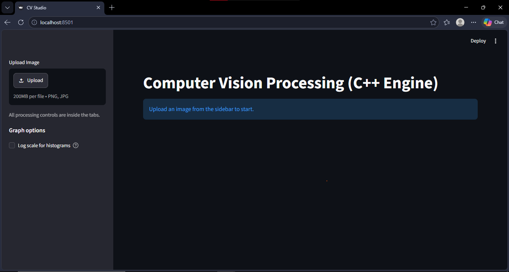
<!-- 📸 ui-overview.png: the whole app with an image loaded, showing the tab bar and the sidebar. -->

*The application: one tab per group of related features, and a sidebar with the image upload.*

## Contents

1. [The task](#1-the-task)
2. [Architecture](#2-architecture)
3. [Features, results and observations](#3-features-results-and-observations)
4. [Setup and run](#4-setup-and-run)
5. [Project files](#5-project-files)
6. [Native API](#6-native-api-enginecpp)
7. [Troubleshooting](#7-troubleshooting)

---

## 1. The task

Build an application that reads RGB and gray images with OpenCV, applies the operations below, and integrates all the algorithms with a UI to test them with different parameters. The report must describe the observations on the results of the different methods and parameter variations. This README is that report.

| # | Requirement | Status | Where |
|---|---|---|---|
| 1 | Add additive noise: Uniform, Gaussian, Salt & Pepper | Done | Tab 1 |
| 2 | Filter the noisy image with low-pass filters: Average, Gaussian, Median | Done | Tab 1 |
| 3 | Edge detection: Sobel, Roberts, Prewitt, Canny, with X and Y direction preview (OpenCV only for Canny) | Done | Tab 2 |
| 4 | Draw the histogram and the distribution curve | Done | Every tab |
| 5 | Equalize the image | Done | Tab 3 |
| 6 | Normalize the image | Done | Tab 3 |
| 7 | Local and global thresholding | Not required (crossed out in the tutorial) | None |
| 8 | Color to gray, R/G/B histograms with their distribution function (the cumulative curve used for mapping and equalization) | Done | Tab 3 |
| 9 | Frequency-domain filters: high-pass and low-pass | Done | Tab 4 |
| 10 | Hybrid images | Done | Tab 5 |

Rules followed from the tutorial: noise generation uses OpenCV for Uniform and Gaussian noise, Salt & Pepper noise and all filters are implemented from their equations, Canny is the only edge detector that uses OpenCV, and the FFT / inverse FFT use a library (`cv::dft`).

## 2. Architecture

```
Streamlit UI (app.py)  --ctypes-->  engine.dll (engine.cpp, C++ + OpenCV)
 upload, decode, display, plots      noise, filters, edges, histograms, FFT
```

| Implemented from scratch in C++ | Uses OpenCV |
|---|---|
| Salt & Pepper noise, convolution (Average, Gaussian, Sobel, Prewitt, Roberts), median filter, histogram, PDF, CDF, equalization, normalization, color to gray, frequency-domain masks, hybrid images | Image decoding, Uniform and Gaussian noise generators (`randu`, `randn`), Canny, DFT / inverse DFT (`cv::dft`), resize |

Performance design:

- The FFT of each image is computed **once**, when the image is loaded, and kept as a native object. Moving a slider only multiplies by a mask and runs one inverse FFT.
- A hybrid image needs a **single** inverse FFT, thanks to the linearity of the transform.
- Frequency masks are cached inside the engine, and processing results are cached by Streamlit, so tabs that did not change are not recomputed.
- Uniform and Gaussian noise are random but cached, so they stay fixed until a parameter changes.

## 3. Features, results and observations

Upload an image from the sidebar, then use the tab of the feature you want. All controls are inside the tabs. The sidebar also has a **Log scale for histograms** option, useful when a few bins (a black background, salt & pepper noise) hide the rest of the histogram.

Every histogram in the application is drawn as a PDF (top) and its CDF (bottom) on the same intensity axis. The PDF is the histogram divided by the number of pixels, and the CDF is its running sum.

### Tab 1: Noise & Smoothing (requirements 1, 2, 4)

**Noise**

| Noise | Parameters | Definition |
|---|---|---|
| Uniform | lower, upper | `out = clamp(in + U(lower, upper))` |
| Gaussian | mean, standard deviation | `out = clamp(in + N(mean, std))` |
| Salt & Pepper | ratio (pepper/salt), density | a fraction `density` of the pixels is replaced: salt (255) with `density / (1 + ratio)` and pepper (0) with `salt * ratio` |

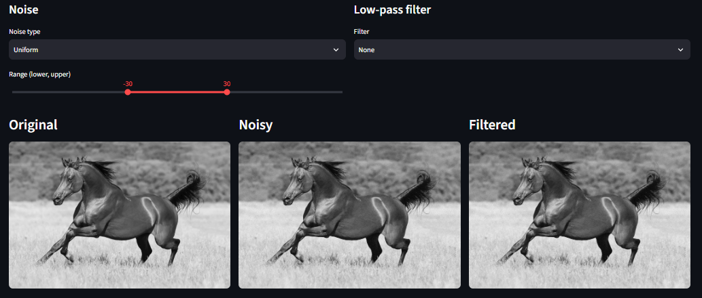
<!-- 📸 noise-uniform.png: Uniform noise selected, filter = None. -->

*Uniform noise (filter = None): the noisy image.*

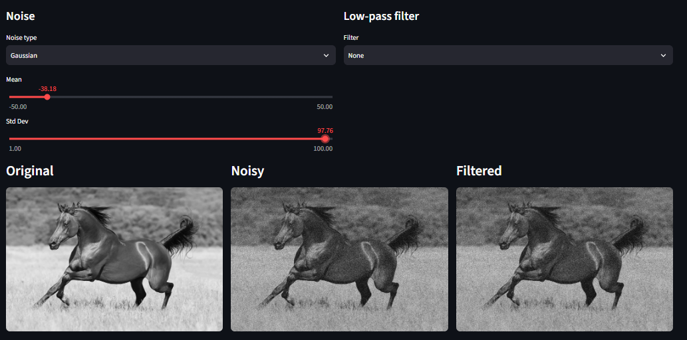
<!-- 📸 noise-gaussian.png: Gaussian noise selected, filter = None. -->

*Gaussian noise (filter = None): the noisy image.*

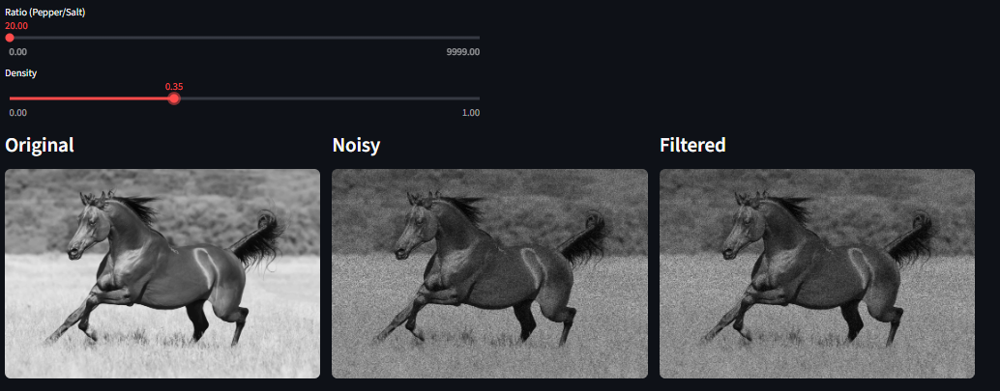
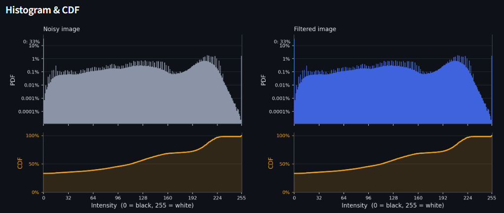
<!-- 📸 noise-salt-pepper.png: Salt & Pepper noise selected, filter = None. -->

*Salt & Pepper noise (filter = None): note the spikes at 0 and 255 in the histogram.*

**Low-pass filters**

| Filter | Parameters | Definition |
|---|---|---|
| Average | kernel size 3, 5 or 7 | every weight is `1 / (k * k)` |
| Gaussian | kernel size, kernel mean, kernel standard deviation | weights `exp(-((x - mean)^2 + (y - mean)^2) / (2 * std^2))`, normalized to sum to 1 |
| Median | kernel size 3, 5 or 7 | the median of the `k * k` neighborhood |

The convolution and the median filter are implemented from scratch, with explicit zero padding at the borders.

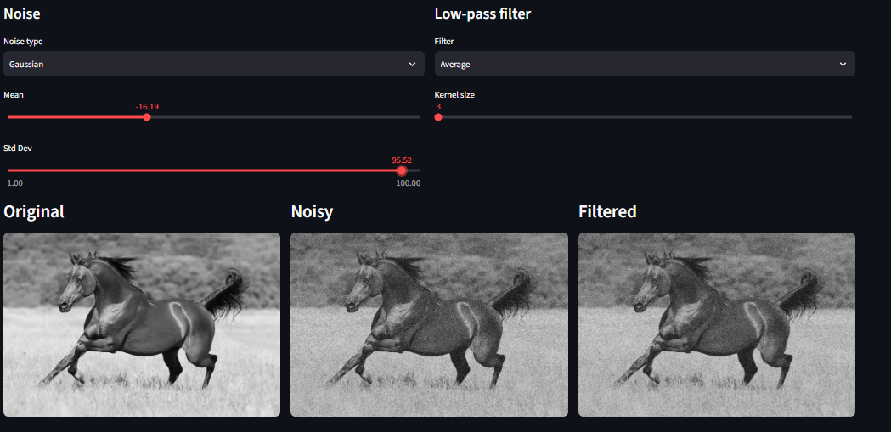
<!-- 📸 filter-average.png: Gaussian or Uniform noise + Average filter. -->

*Average filter applied to a noisy image.*

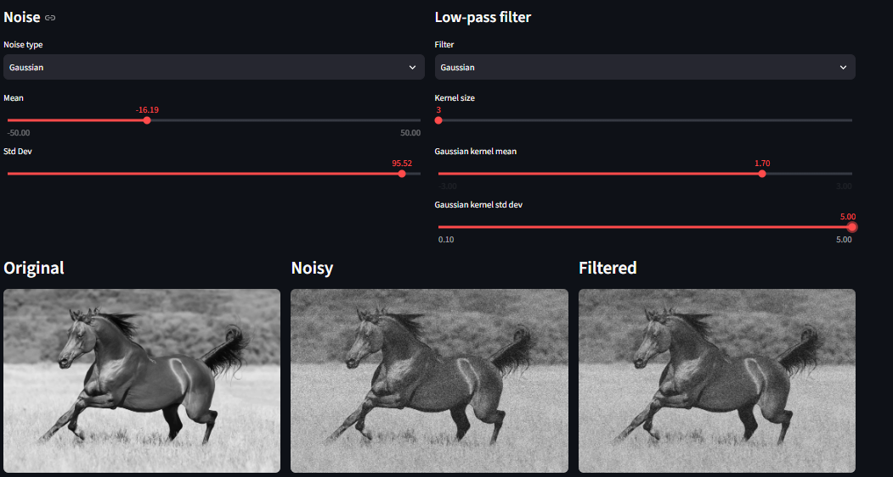
<!-- 📸 filter-gaussian.png: noise + Gaussian filter, show the kernel mean / std controls. -->

*Gaussian filter, with its kernel mean and standard deviation controls.*

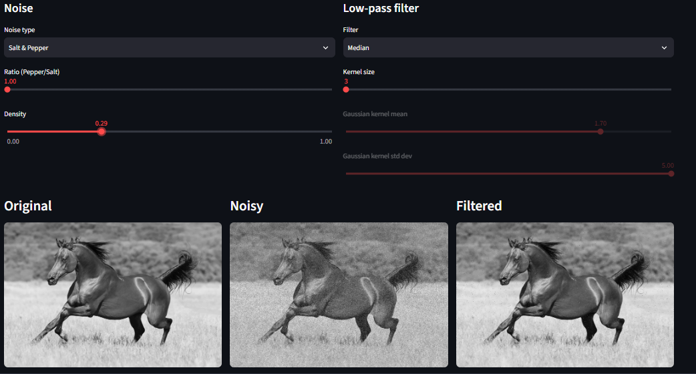
<!-- 📸 filter-median.png: Salt & Pepper noise + Median filter (the case where it beats the box filter). -->

*Median filter on Salt & Pepper noise.*

**Observations**

- Increasing the Uniform range or the Gaussian standard deviation makes the noise stronger and the noisy histogram wider.
- The Average filter reduces Uniform and Gaussian noise but blurs the edges, and a larger kernel blurs more. It does not remove Salt & Pepper noise: it spreads each outlier over its neighborhood.
- The Gaussian filter weights the center pixel more than the Average filter, so for the same kernel size it blurs less. A larger standard deviation blurs more.
- The Median filter removes Salt & Pepper noise almost completely while keeping the edges, so it is the best choice for that noise. It is less effective than the Gaussian filter on Gaussian noise.
- Because of the zero padding, the pixels at the borders of the filtered image get slightly darker.

### Tab 2: Edge Detection (requirements 3, 4)

| Detector | Masks (X direction, Y direction) |
|---|---|
| Sobel | `[-1 0 1; -2 0 2; -1 0 1]` and its transpose |
| Prewitt | `[-1 0 1; -1 0 1; -1 0 1]` and its transpose |
| Roberts | `[1 0; 0 -1]` and `[0 1; -1 0]` |
| Canny | OpenCV, thresholds 100 and 200, no direction |

For Sobel, Prewitt and Roberts the **X and Y results are shown side by side**. X highlights vertical edges and Y highlights horizontal edges. The output is the absolute response saturated to 8 bits. The option **Add the noise selected in the first tab** applies that noise before detecting edges.

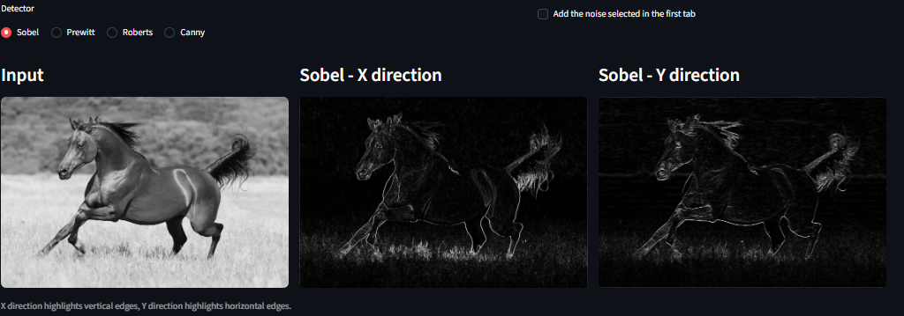
<!-- 📸 edge-sobel.png: Sobel with the Input, X and Y results visible. -->

*Sobel: input, X direction and Y direction.*

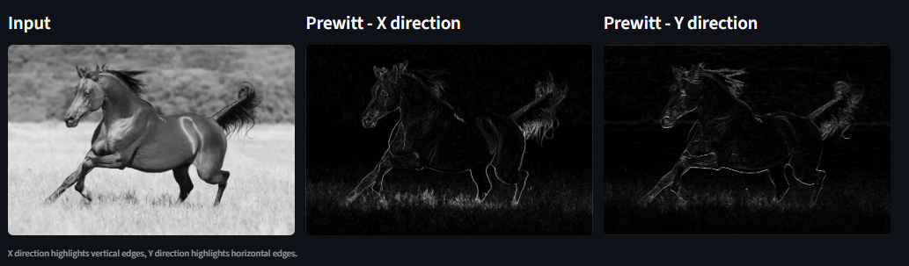
<!-- 📸 edge-prewitt.png: Prewitt with the Input, X and Y results visible. -->

*Prewitt: input, X direction and Y direction.*

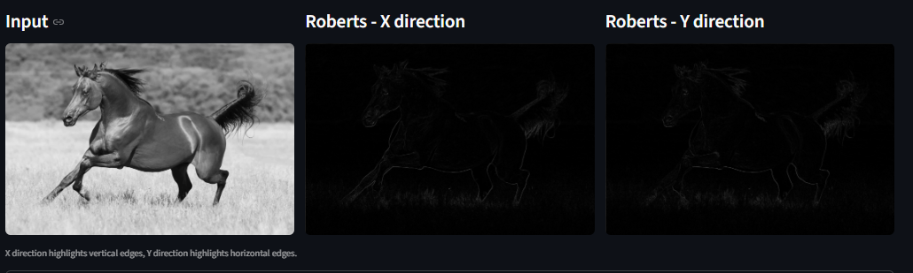
<!-- 📸 edge-roberts.png: Roberts with the Input, X and Y results visible. -->

*Roberts: input, X direction and Y direction.*

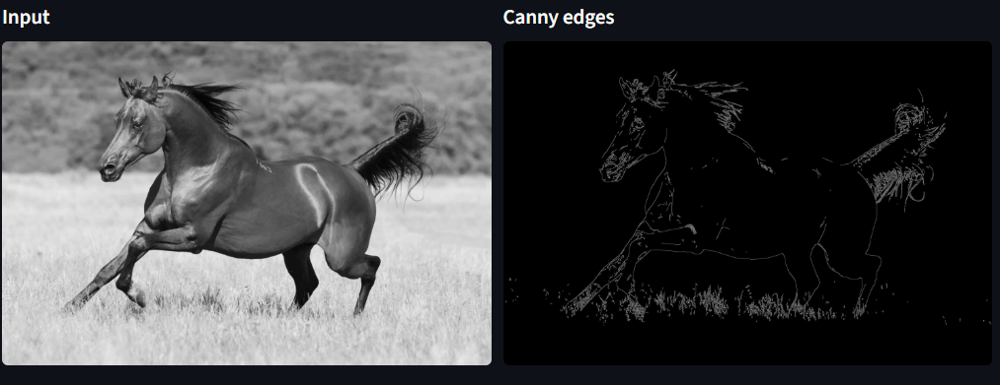
<!-- 📸 edge-canny.png: Canny result. -->

*Canny edge detector.*

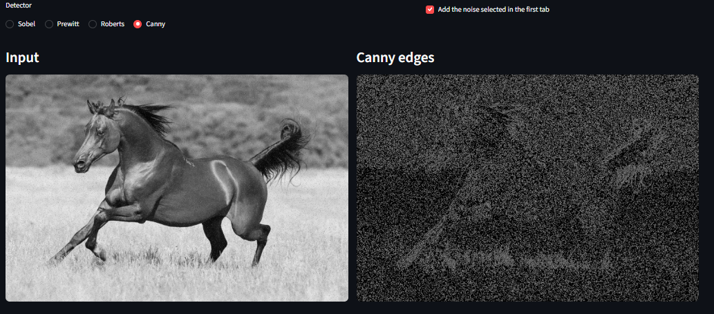
<!-- 📸 edge-on-noisy.png: "Add the noise selected in the first tab" enabled, any detector. -->

*Edge detection on a noisy image.*

**Observations**

- The X result shows mostly vertical edges and the Y result shows mostly horizontal edges. Both together describe the full edge map.
- Sobel gives more weight to the center row and column than Prewitt, so its response is slightly stronger and smoother.
- Roberts uses a 2x2 mask, so it is very localized and the most sensitive to noise.
- Sobel, Prewitt and Roberts are high-pass operators: with noise they produce many false edges. Canny is more robust because it smooths the image first, and it gives thin, connected edges.

### Tab 3: Histogram & Contrast (requirements 4, 5, 6, 8)

- **Equalization:** `new = round(255 * CDF[old])`.
- **Normalization (linear stretch):** `new = (old - min) / (max - min) * 255`.
- **Color to gray:** `Gray = 0.299 R + 0.587 G + 0.114 B`.
- The tab shows the original, equalized and normalized images with their histograms, a CDF comparison plot (against the ideal uniform line), and the color section: R, G, B and gray histograms with their CDFs, and equalization using the gray CDF as the mapping curve.
- When a single gray level holds a large share of the pixels (for example a pure white background), that bin is labelled on the PDF and linked by a dotted line to the jump in the CDF.

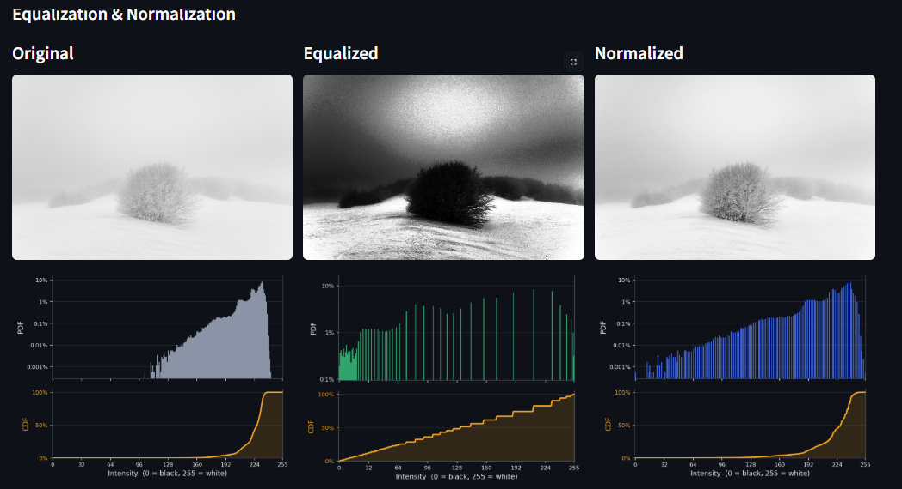
<!-- 📸 contrast-equalize-normalize.png: Original / Equalized / Normalized with their histograms, using a low-contrast image. -->

*Original, equalized and normalized images with their histograms, on a low-contrast image.*

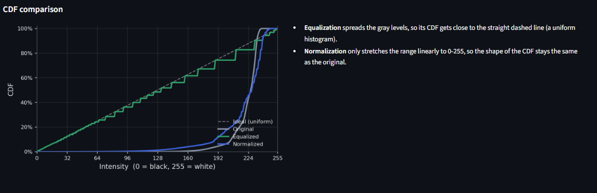
<!-- 📸 contrast-cdf-comparison.png: the CDF comparison plot. -->

*CDF comparison of the original, equalized and normalized images.*

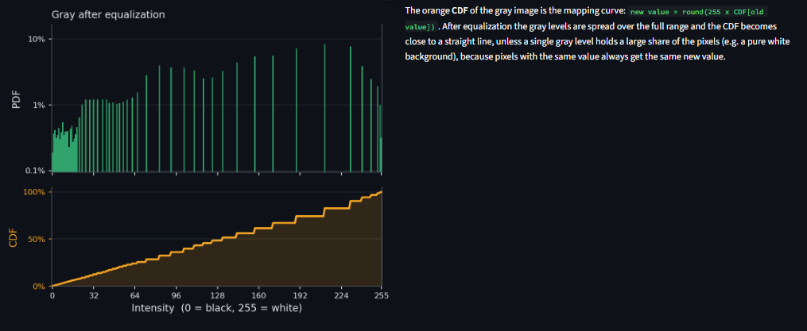
<!-- 📸 color-gray-equalization.png: equalized gray image and its histogram. -->

*Equalization of the gray image using its CDF, and the resulting histogram.*

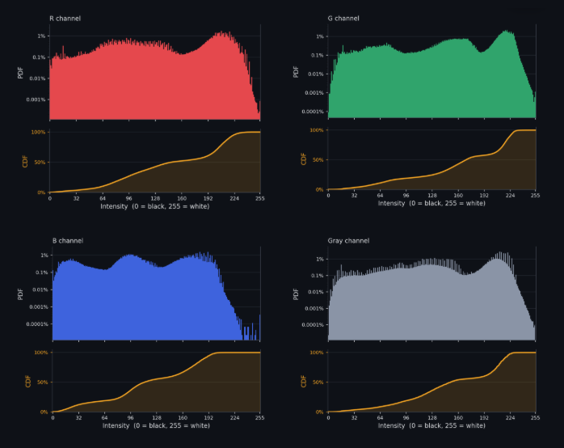
<!-- 📸 color-rgb-histograms.png: color image, grayscale image and the R/G/B/Gray plots. -->

*Color image, grayscale image, and the R, G, B and gray histograms with their CDFs.*

**Observations**

- Equalization spreads the gray levels over the full range, so a low-contrast image gets a much better contrast and its CDF gets close to the straight line.
- Equalization amplifies the noise, and because the mapping is discrete, the equalized histogram has gaps (it looks like a comb).
- If one gray level holds a large share of the pixels (a white background), the equalized CDF cannot become a straight line, because pixels with the same value always get the same new value.
- Normalization only stretches the range linearly, so the **shape** of the histogram and the CDF does not change. It has no effect on an image that already uses the full 0 to 255 range.
- The green channel contributes the most to the gray level (weight 0.587), then red (0.299) and blue (0.114).

### Tab 4: Frequency Domain (requirements 9, 4)

Low-pass and high-pass filtering with three masks, where `D` is the distance from the center of the spectrum and `D0` is the cutoff:

| Mask | Low-pass `H` |
|---|---|
| Ideal | `1` if `D <= D0`, else `0` |
| Gaussian | `exp(-D^2 / (2 * D0^2))` |
| Butterworth | `1 / (1 + (D / D0)^(2n))`, with an adjustable order `n` |

The low-pass filter uses `H` and the high-pass filter uses `1 - H`. The image is padded to the optimal DFT size, filtered, transformed back and cropped. The tab shows the original image with its log-magnitude spectrum, and the filtered images with their filtered spectra.

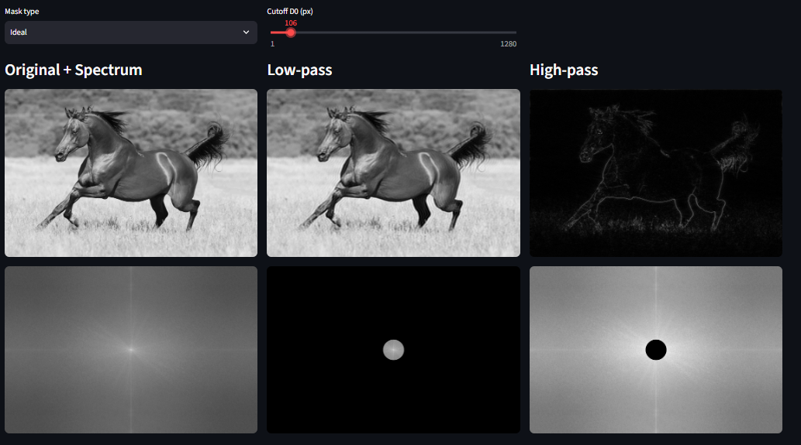
<!-- 📸 freq-ideal.png: Ideal mask, low-pass and high-pass results with spectra (the ringing is visible). -->

*Ideal mask: low-pass and high-pass results with their spectra.*

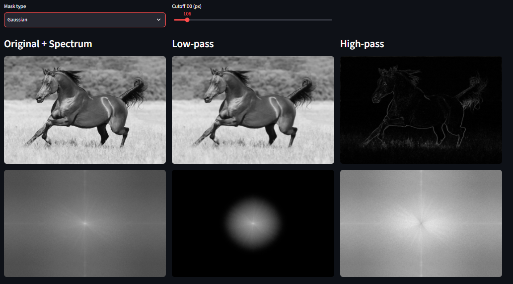
<!-- 📸 freq-gaussian.png: Gaussian mask. -->

*Gaussian mask: low-pass and high-pass results with their spectra.*

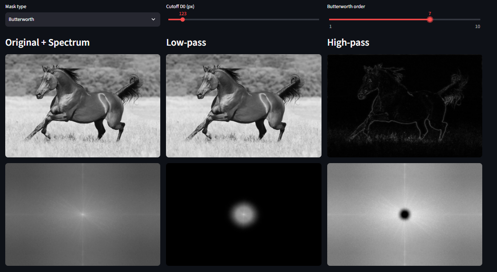
<!-- 📸 freq-butterworth.png: Butterworth mask, show the order slider. -->

*Butterworth mask, with its order slider.*

**Observations**

- The bright center of the spectrum holds the low frequencies (the average intensity and the smooth regions), and the high frequencies are far from the center.
- The low-pass result is a blurred image, and the blur grows as `D0` gets smaller. The high-pass result keeps mostly the edges and the fine details, on a dark background (the average intensity is removed).
- The Ideal mask has a sharp cutoff, so it produces visible ringing around the edges. The Gaussian mask has no ringing. Butterworth is in between, and a higher order behaves more like the Ideal mask.

### Tab 5: Hybrid Images (requirement 10)

- Upload a second image. It is resized to the size of the main image inside the C++ engine.
- By default the main image gives the low frequencies and the second image gives the high frequencies. The option **Swap roles** exchanges them.
- The result is `F_low * LP(D_low) + F_high * (1 - LP(D_high))`, followed by a single inverse FFT.
- Options: mask type, Butterworth order, low-pass cutoff and high-pass cutoff. A preview downscaled 4 times shows what the image looks like from far away.

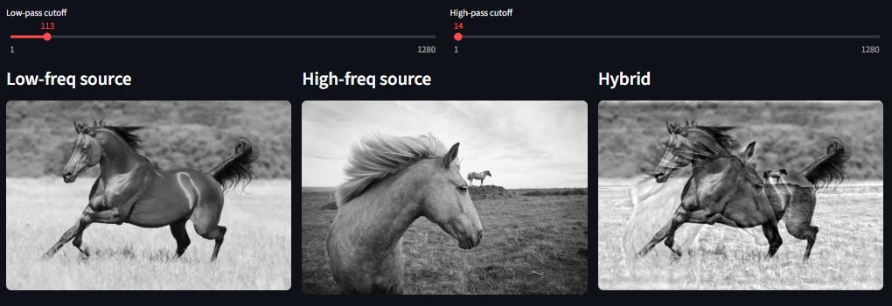
<!-- 📸 hybrid-result.png: low-frequency source, high-frequency source and the hybrid result. -->

*The low-frequency source, the high-frequency source and the hybrid result.*

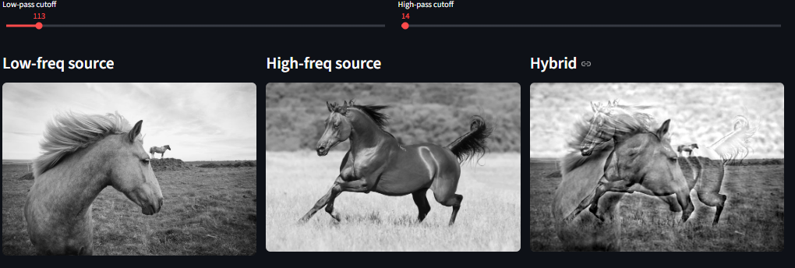
<!-- 📸 hybrid-swapped.png: same pair with "Swap roles" enabled. -->

*The same pair of images with the roles swapped.*

**Observations**

- Up close, the image that provides the high frequencies is the one you see. From far away, or in the downscaled preview, the image that provides the low frequencies dominates.
- The effect works best when the two images are aligned (for example two faces with the eyes at the same place).
- A smaller low-pass cutoff keeps only the coarse shapes of the first image. A larger high-pass cutoff keeps only the finest details of the second image. If the two cutoffs are too close, both images become visible at the same time.

## 4. Setup and run

### Requirements

- Windows 10 or later
- Python 3.10 or later
- A recent Streamlit (the app uses `st.image(..., width="stretch")`): `pip install --upgrade streamlit`
- Python packages: `streamlit`, `numpy`, `opencv-python`, `matplotlib`
- One C++ toolchain with its own OpenCV: **MinGW-w64 (MSYS2)** or **Visual Studio (MSVC)**. Do not mix them: run the DLL with the OpenCV of the toolchain that built it.

### 1. Create a Python environment

From the project folder:

```powershell
python -m venv .venv
Set-ExecutionPolicy -Scope Process -ExecutionPolicy RemoteSigned
.\.venv\Scripts\Activate.ps1
python -m pip install --upgrade pip
pip install streamlit numpy opencv-python matplotlib
```

### 2. Build the C++ engine

Keep `app.py` and `engine.cpp` in the same folder. The resulting `engine.dll` must end up **next to `app.py`**.

#### Option A: MinGW-w64 (MSYS2)

Install MSYS2 from [msys2.org](https://www.msys2.org/) (default location `C:\msys64`) and install the compiler, OpenCV and the Qt6 runtime:

```powershell
& "C:\msys64\usr\bin\bash.exe" -lc "pacman -Syu --noconfirm"
& "C:\msys64\usr\bin\bash.exe" -lc "pacman -S --needed --noconfirm mingw-w64-x86_64-gcc mingw-w64-x86_64-opencv mingw-w64-x86_64-qt6-base"
```

If MSYS2 asks to close and reopen its terminal during the first update, do so, then run the second command. Then build (repeat the `$env:Path` line in every new terminal):

```powershell
$env:Path = "C:\msys64\mingw64\bin;$env:Path"
g++ -O3 -std=c++17 -shared -o engine.dll engine.cpp -IC:\msys64\mingw64\include\opencv5 -LC:\msys64\mingw64\lib -lopencv_core -lopencv_imgproc
```

If the compiler cannot find the OpenCV headers, check whether they are in `include\opencv4` instead of `include\opencv5` and adjust the `-I` path. If MSYS2 is installed somewhere else, set `$env:MINGW64_BIN = "D:\path\to\msys64\mingw64\bin"` before building and running.

#### Option B: Visual Studio (MSVC)

Download the OpenCV Windows package and extract it to `C:\opencv` (so that `C:\opencv\opencv\build\x64\vc16\bin` exists). Open **x64 Native Tools Command Prompt for VS**, go to the project folder and check the name of the OpenCV library:

```
dir C:\opencv\opencv\build\x64\vc16\lib\opencv_world*.lib
```

Build with the release library (the one without the `d` before `.lib`), replacing `<version>` with the number you see:

```
cl /nologo /O2 /EHsc /std:c++17 /LD engine.cpp /I C:\opencv\opencv\build\include /link /LIBPATH:C:\opencv\opencv\build\x64\vc16\lib opencv_world<version>.lib /OUT:engine.dll
```

Building from an IDE (Rider, CLion, Visual Studio with CMake) also works, as long as the DLL is built in Release mode and copied next to `app.py`.

`app.py` adds `C:\opencv\opencv\build\x64\vc16\bin` and the MinGW directory (`MINGW64_BIN` or `C:\msys64\mingw64\bin`) to the DLL search path when they exist. If OpenCV is installed somewhere else, edit `opencv_bin` at the top of `app.py`.

### 3. Run the application

Use the virtual environment's Python directly (after building, `python` may resolve to MSYS2's Python instead of the venv):

```powershell
.\.venv\Scripts\python.exe -m streamlit run app.py
```

Open the URL printed by Streamlit, usually `http://localhost:8501`.

Rebuild `engine.dll` after changing `engine.cpp`. Python-only interface changes do not require rebuilding it.

## 5. Project files

- `app.py`: the Streamlit interface (tabs, plots) and the Python-to-C++ bridge. It does no image processing.
- `engine.cpp`: the native engine (see the API below).
- `engine.dll`: generated build output, not committed to Git.
- `docs/screenshots/`: the images used in this README.

Suggested `.gitignore`:

```
.venv/
engine.dll
Release/
cmake-build-*/
```

## 6. Native API (`engine.cpp`)

| Function | Purpose |
|---|---|
| `run_pipeline` | Noise, then one of: Average, Gaussian, Median, Sobel, Prewitt, Roberts, Canny, Equalize, Normalize. Returns the noisy image, the result and the histogram. |
| `hist_to_pdf_cdf` | 256 histogram counts to PDF and CDF. |
| `color_analysis` | Color to gray, R/G/B/Gray histograms with PDF and CDF, equalization with the gray CDF. |
| `fd_create` / `fd_free` | Create and free a frequency-domain object (computes the FFT once). |
| `fd_spectrum` | Log-magnitude spectrum for display. |
| `fd_filter` | Low-pass or high-pass filtering (Ideal, Gaussian, Butterworth). |
| `fd_hybrid` | Hybrid image with a single inverse FFT. |

## 7. Troubleshooting

### `Could not find module engine.dll`

Make sure `engine.dll` exists in the same folder as `app.py`, and that the DLL directories of the toolchain you built with are available (`C:\opencv\opencv\build\x64\vc16\bin` for MSVC, `MINGW64_BIN` or `C:\msys64\mingw64\bin` for MinGW). A DLL built with one toolchain does not load with the OpenCV of the other.

### `function '...' not found` (for example `hist_to_pdf_cdf`)

`app.py` loaded an outdated `engine.dll`. Close Streamlit (Windows locks a loaded DLL, so the new build cannot replace it), rebuild `engine.cpp`, and check that the `engine.dll` next to `app.py` has a new modification time. If your build writes into `Release\`, copy it next to `app.py`:

```powershell
Get-Process python* | Stop-Process -Force
Copy-Item .\Release\engine.dll .\engine.dll -Force
```

### `g++ is not recognized`

The MinGW path is not set in this terminal. Run:

```powershell
$env:Path = "C:\msys64\mingw64\bin;$env:Path"
```

### `No module named streamlit` (or `matplotlib`)

`python` is resolving to MSYS2's Python, not the venv. Use the venv's Python directly:

```powershell
.\.venv\Scripts\python.exe -m pip install streamlit numpy opencv-python matplotlib
.\.venv\Scripts\python.exe -m streamlit run app.py
```

### Missing Qt6 or OpenCV DLLs (MinGW)

Install the runtime packages again:

```powershell
& "C:\msys64\usr\bin\bash.exe" -lc "pacman -S --needed --noconfirm mingw-w64-x86_64-opencv mingw-w64-x86_64-qt6-base"
```

### `invalid signature` or very slow downloads in MSYS2

Run `pacman-key --init && pacman-key --populate msys2` through `bash.exe -lc`, then `pacman -Sy --disable-download-timeout`.

### PowerShell blocks environment activation

Run this once in the current PowerShell session, then activate the environment again:

```powershell
Set-ExecutionPolicy -Scope Process -ExecutionPolicy RemoteSigned
```
